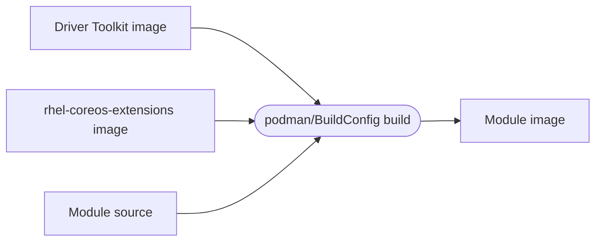
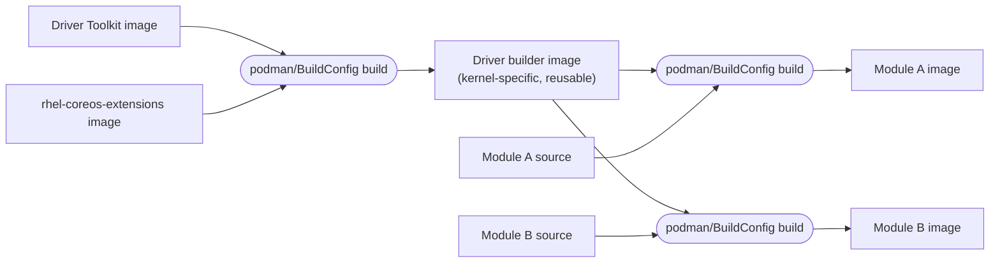

# Driver module build flows

Two ways to combine the Driver Toolkit and `rhel-coreos-extensions` images,
depending on whether you want a one-off module image or a reusable,
kernel-specific builder for several modules.

## 1. Direct: build a module image in one step

Inputs: Driver Toolkit image, `rhel-coreos-extensions` image, module source.
Output: a single module image (compiled `.ko` + minimal runtime base).

This is the path documented in [Building locally with podman](../README.md#building-locally-with-podman)
- a single `Containerfile`/build installs the matching kernel packages from
the extensions image and compiles the module source against the Driver
Toolkit's kernel-devel in one pass.

## 2. Reusable: build a kernel-specific builder image first

Inputs: Driver Toolkit image, `rhel-coreos-extensions` image.
Output: a builder image with the matching kernel packages (kernel-devel,
headers, etc.) already installed for one specific `KVER`.

That builder image is then reused as the base for any number of module
builds against the same kernel - each only needs to add its own module
source, skipping the kernel-package install step every time. It's tied to a
single kernel version, so a new builder is needed whenever the target
`KVER`/Driver Toolkit changes (e.g. a new OpenShift release).
